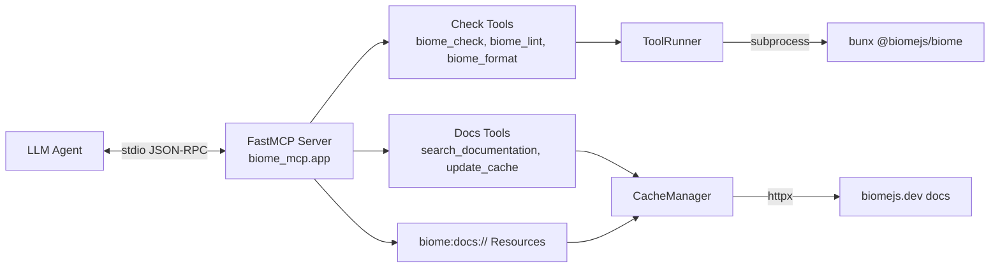
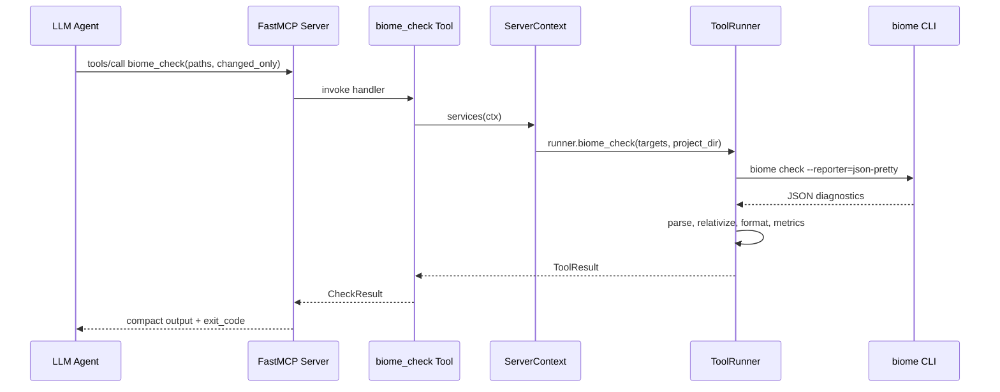

# biome-mcp Documentation

biome-mcp is a Model Context Protocol (MCP) server that gives LLM agents
read-only access to [Biome](https://biomejs.dev/) on TypeScript and web
projects, with compact output that keeps long check runs cheap to read.

The docs are ordered by progressive disclosure. Start at the top of the list;
dive deeper only when you need the detail.

## Reading Paths

| If you want to... | Start with... |
|---|---|
| Understand what the server is and how a request flows | [Architecture](architecture.md) |
| Connect the server to your agent and tune it | [Configuration](configuration.md) |
| Know every tool, resource, and prompt available | [Tools & Resources](tools.md) |
| Build, test, or extend the codebase | [Development](development.md) |

## Architecture at a Glance

The server is a thin shell: tools translate arguments into Biome CLI
invocations, a runner executes them and parses the JSON output, and a
formatting layer compresses diagnostics before the model ever sees them. The
documentation cache fetches and parses Biome's official docs so agents can
answer CLI, configuration, and linter questions offline.

## The Lifecycle of a Check

Every tool returns a `CheckResult`: the compact `output` text, the underlying
`exit_code`, and counts (`issues`, `fixable`, `warnings`) plus token-savings
estimates. A nonzero `exit_code` always means the check failed, even when a
severity filter hides diagnostics.

## Components

| Component | Module | Responsibility |
|---|---|---|
| CLI entrypoint | `biome_mcp/cli/app.py` | Typer CLI; starts the server or installs the skill |
| FastMCP app | `biome_mcp/app.py` | Server instance and lifespan wiring |
| Server context | `biome_mcp/context.py` | Shared runner, docs cache, and project dir |
| Settings | `biome_mcp/settings.py` | `BIOME_MCP_*` environment configuration |
| Tool runner | `biome_mcp/runner.py` | Executes Biome and produces `ToolResult`s |
| Output formatting | `biome_mcp/formatting.py` | Parses JSON and compresses diagnostics |
| Models | `biome_mcp/models.py` | Pydantic data models for results and diagnostics |
| Docs cache | `biome_mcp/docs/` | Fetches, parses, and searches Biome documentation |
| Agent skill | `biome_mcp/skills/biome/` | Bundled skill installed via `skill install` |

## Key Design Decisions

- **Read-only by construction.** No tool writes to source files. `biome
  format` runs in check mode only; fixes belong to the agent's editing
  workflow.
- **Structured parsing.** Tools ask Biome for `json-pretty` output instead of
  parsing human-readable text, which would break on Biome version changes.
- **Adaptive aggregation.** Small result sets are grouped by file. Large sets
  (25+ issues or 6+ files) switch to rule/file rollups plus capped detail
  lines, trading precision for context savings.
- **Standalone documentation cache.** Docs are fetched once at startup (or on
  demand via `update_cache`), stored as parsed JSON, and served as resources —
  the agent never depends on live network access for doc lookups.

Next: [Configuration](configuration.md) covers client setup, environment
variables, and common failure modes.
