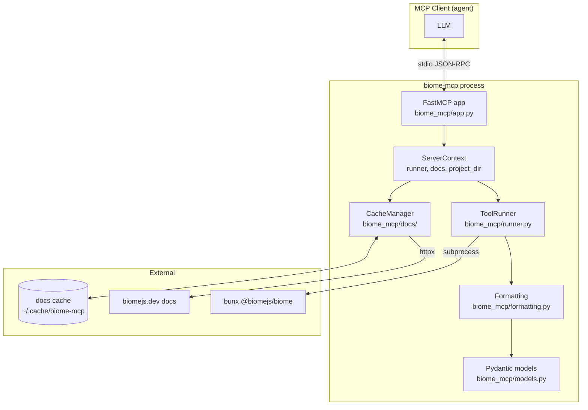
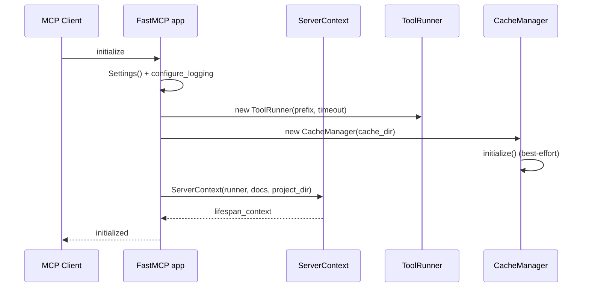
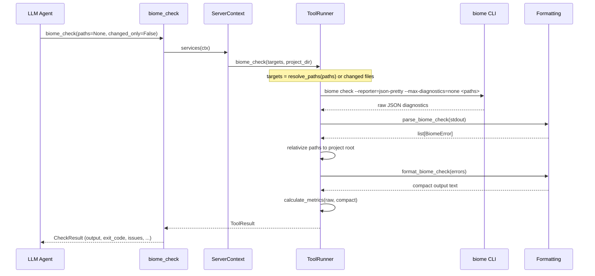
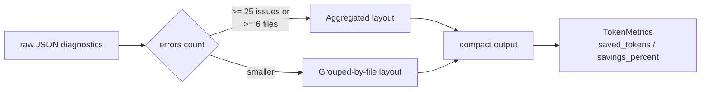
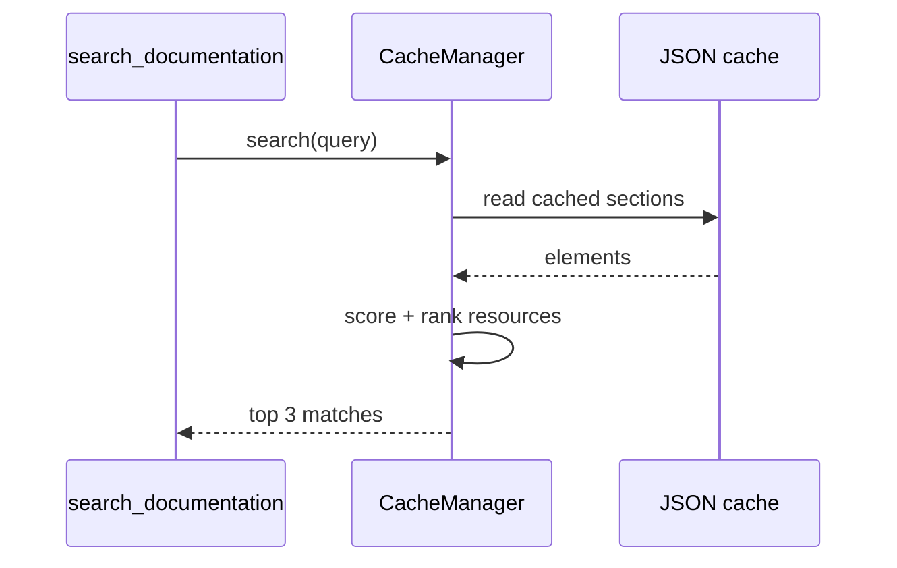

# Architecture

This page explains how biome-mcp is built and how a request travels through
it. It assumes you know what an MCP server is; if you do not, skim the
[Protocol](https://modelcontextprotocol.io) first, then come back.

## Components



The process has one entry point, `biome_mcp.cli:run`, a Typer app. With no
subcommand it starts the FastMCP server; `skill install` copies the bundled
agent skill into a project.

## Lifecycle and Lifespan

The FastMCP app is defined in `biome_mcp/app.py`. Its `lifespan` runs once
when the server starts and builds the shared services every tool needs:

1. Load `Settings` from `BIOME_MCP_*` environment variables
   (`biome_mcp/settings.py`).
2. Configure logging to **stderr** — never stdout, which is reserved for MCP
   JSON-RPC messages.
3. Create a `ToolRunner` with the configured command prefix and timeout.
4. Create a `CacheManager` and initialize the documentation cache.
5. Yield a `ServerContext` holding the runner, docs cache, and resolved
   project directory.



Tools pull the context through the `services(ctx)` helper
(`biome_mcp/context.py`), which casts the FastMCP lifespan context to the
typed `ServerContext`. That keeps tool handlers free of wiring.

## A Check Request, Step by Step

Take `biome_check` as the canonical example. `biome_lint` and `biome_format`
are the same pipeline with different flags.



### Target resolution

- `changed_only=false` (default): the tool expands `paths` (files,
  directories, or globs like `src/**/*.ts`) into concrete paths. Empty paths
  means the whole project.
- `changed_only=true`: `changed_web_files()` asks git for staged, unstaged,
  and untracked web files (`*.ts`, `*.tsx`, `*.js`, `*.jsx`, `*.mts`, `*.cts`,
  `*.mjs`, `*.cjs`, `*.json`, `*.jsonc`, `*.css`, `*.html`, `*.graphql`,
  `*.vue`, `*.astro`, `*.svelte`). It takes precedence over `paths`. If git
  reports no modified web files, the tool returns
  `No modified web files found.` with `exit_code=0`.

### Output processing

Raw Biome JSON is parsed into `BiomeError` models
(`biome_mcp/models.py`), then rendered two ways depending on size
(`biome_mcp/formatting.py`):



- **Grouped layout** (default): `## file` headers with one
  `L{line}:{col} [{level}{fixable}:{code}] message` line per diagnostic.
- **Aggregated layout** (large runs): `Top rules` and `Top files` rollups,
  then up to 50 flat `Violations` lines, with `... +N more issues` when
  capped.

Every result carries the real `exit_code` from Biome, so a severity filter in
`biome_lint` never masks a failed check — the model must inspect `exit_code`.

## Documentation Cache

`biome_mcp/docs/` mirrors three Biome docs pages into structured JSON:

| Section | Source page |
|---|---|
| `cli` | `https://biomejs.dev/reference/cli/` |
| `configuration` | `https://biomejs.dev/reference/configuration/` |
| `linter` | `https://biomejs.dev/linter/javascript/rules/` |

The cache lives in `~/.cache/biome-mcp/docs` (respecting `XDG_CACHE_HOME`),
overridable via `BIOME_MCP_CACHE_DIR`. It is populated at startup
best-effort — the server starts even if the network is down. `update_cache`
refreshes it and records the npm-published Biome version so the cache can be
validated against the current release.



Resources are exposed to the agent as `biome:docs://` URIs:

- `biome:docs://{section}` — overview of a section
- `biome:docs://{section}/{command}` — one command or rule
- `biome:docs://{section}/{command}/{subsection}` — one subsection

## Error Handling

`biome_mcp/errors.py` defines two exceptions:

| Exception | Raised when |
|---|---|
| `ToolError` | Base class for tool execution errors |
| `ToolNotFoundError` | The Biome executable cannot be found or a command times out |

The runner never raises on nonzero exit codes — those are returned inside
`ToolResult`/`ProcessResult`. Errors like a missing binary, on the other hand,
surface as `ToolNotFoundError`, which tools let propagate to the client.

## Project Layout

```
src/biome_mcp/
├── __init__.py        # __version__
├── app.py             # FastMCP app + lifespan
├── cli/               # Typer CLI: server start, skill install
├── context.py         # ServerContext + services() helper
├── docs/              # documentation cache (fetch, parse, search)
├── errors.py          # ToolError hierarchy
├── formatting.py      # parse + compact formatting
├── models.py          # Pydantic models
├── resources/         # biome:docs:// MCP resources
├── runner.py          # subprocess execution + git helpers
├── server.py          # imports tools/resources, exposes mcp
├── settings.py        # pydantic-settings BaseSettings
├── skills/            # bundled agent skill (installed via CLI)
└── tools/             # MCP tools (checks, docs)
```

Next: [Configuration](configuration.md) — environment variables, client
setup, and failure modes.
